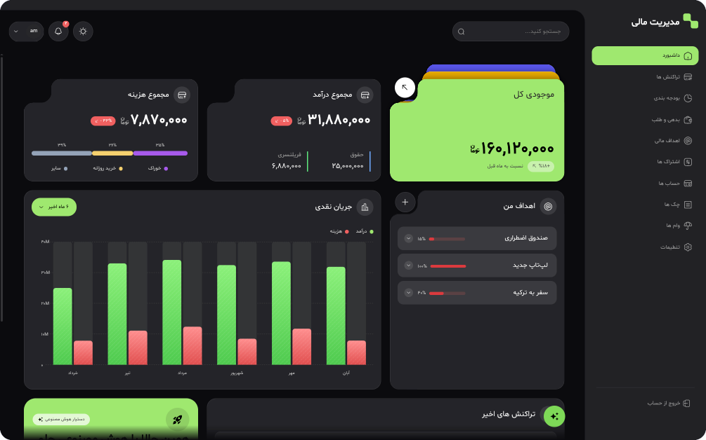
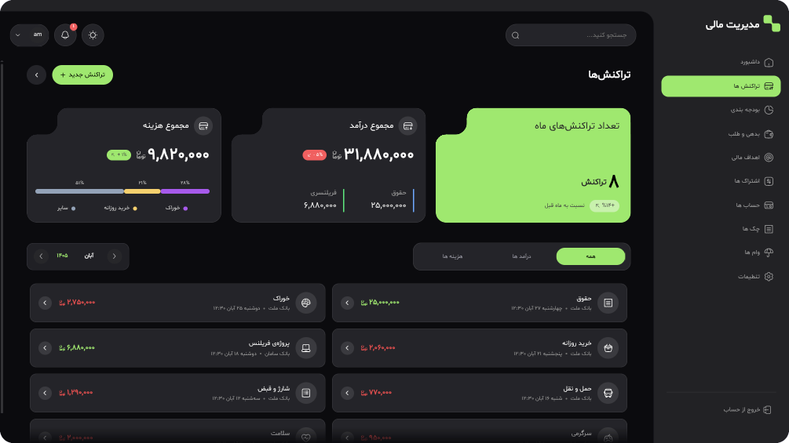
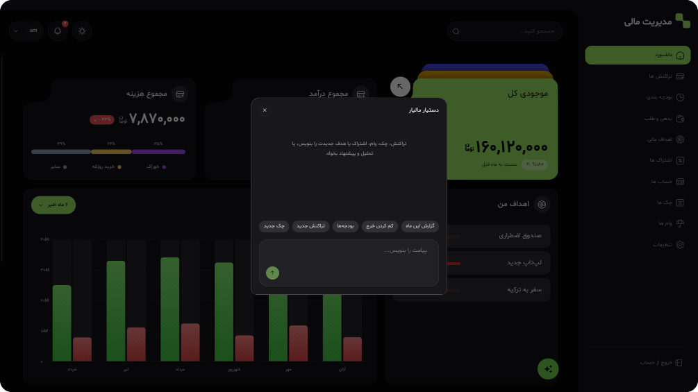

<div align="center">

# Maliyar (مالیار)

**A personal finance management app with a Persian-first, RTL interface and an AI assistant.**

Track accounts, transactions, budgets, loans, checks, subscriptions, dues and savings goals in one place.


[Live Demo](#) · [Report a Bug](../../issues)
</div>

---

## Screenshots

<!-- Replace with real screenshots -->
| Dashboard | Transactions | AI Chat |
| --- | --- | --- |
|  |  |  |

## Features

**Money management**
- **Accounts**: bank cards and a cash wallet, with optional card number and IBAN
- **Transactions**: income and expenses, filtered by Jalali month and year
- **Budgets**: monthly budgets per category with progress tracking
- **Dues**: debts and claims, with payments linked to real transactions
- **Loans**: installment schedules, pay from an account or mark as paid by someone else, undo last payment
- **Checks**: incoming and outgoing checks with pending, cashed and bounced statuses
- **Subscriptions**: recurring payments that advance their next payment date when paid
- **Goals**: savings goals with optional deadlines and linked savings accounts

**AI assistant**
- Add entries from plain text (transaction, check, loan, goal, subscription, due, budget)
- Analyze your finances and get suggestions
- Every AI suggestion is a draft. Nothing is saved until you confirm it

**Experience**
- Persian RTL layout with the Shabnam font and Jalali calendar
- Fully responsive, with a bottom navigation bar on mobile
- Settings: profile, security, preferences, CSV export, sample data

## Tech Stack

| Layer | Technology |
| --- | --- |
| Frontend | React, TypeScript, Tailwind CSS, HeroUI v3 |
| Backend & database | Convex |
| Auth | Username or email + password |
| AI | Z.ai API (GLM-4.7-Flash) via plain `fetch` |
| UI extras | keen-slider, Solar Icons |

## Getting Started

### Prerequisites

- Node.js 18+
- A [Convex](https://www.convex.dev) account
- A [Z.ai](https://z.ai) API key (free model)

### Installation

```bash
git clone https://github.com/abolfazlmahdikhanii/maliyar.git
cd maliyar
npm install
```

### Environment variables

Set the AI key in your Convex deployment (not in the frontend):

```bash
npx convex env set ZAI_API_KEY your_key_here
```

### Run

```bash
# Terminal 1: backend
npx convex dev

# Terminal 2: frontend
npm run dev
```

## Project Structure

```
maliyar/
├── convex/          # Backend: schema, queries, mutations, AI action
├── src/
│   ├── components/  # Shared UI (cards, forms, modals)
│   ├── pages/       # Dashboard, transactions, budgets, loans, ...
│   └── data/        # Banks and categories display data
└── README.md
```

## Notes

Maliyar is a portfolio project, not a commercial product.

## Author

**Abolfazl Mahdikhani**

[GitHub](https://github.com/abolfazlmahdikhanii) · [LinkedIn](https://www.linkedin.com/in/abolfazlmahdikhanii)
